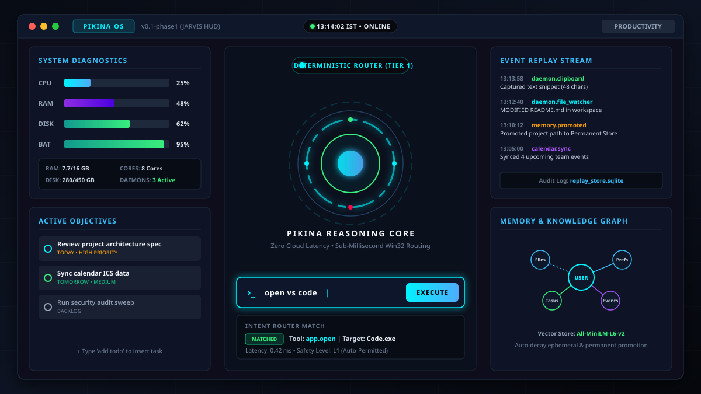
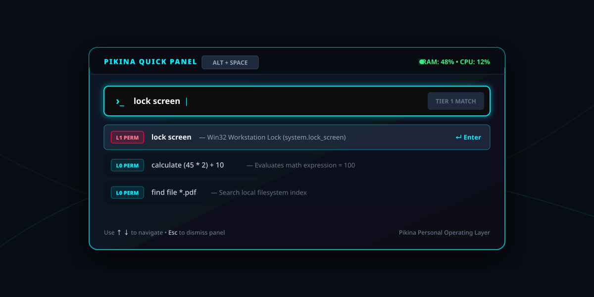
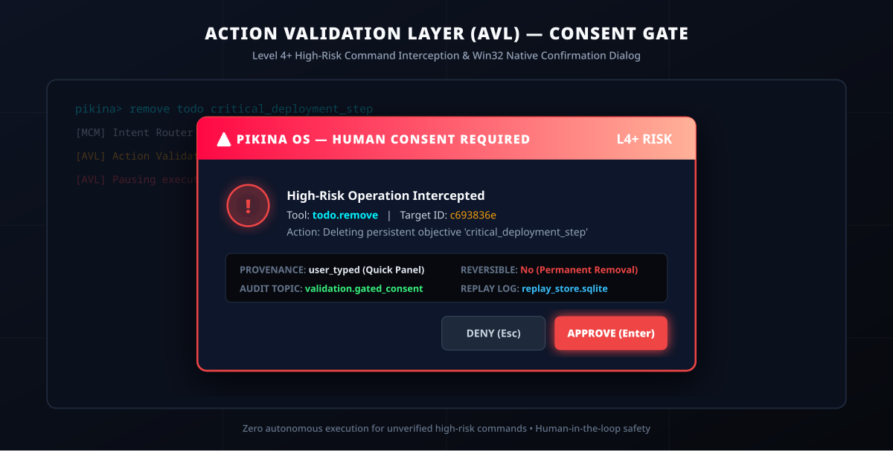
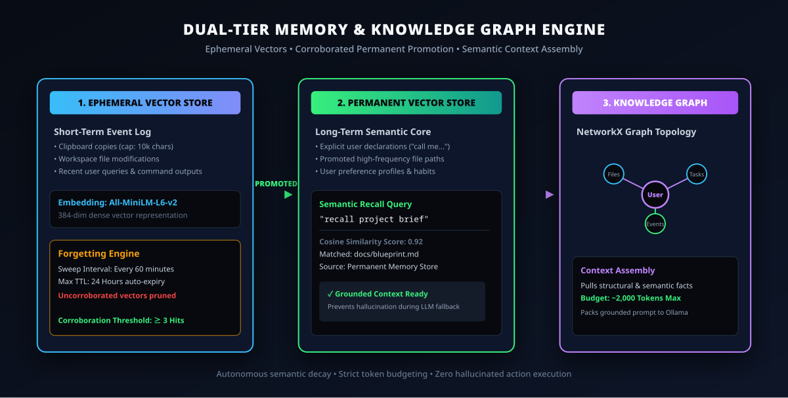
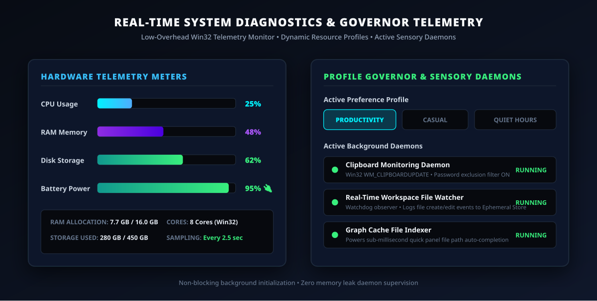
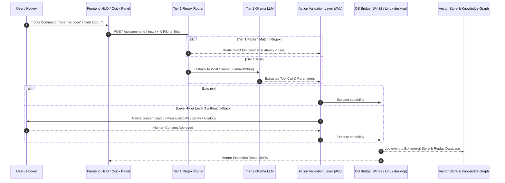

<div align="center">

# ⚡ PIKINA OS

### *Offline-First, Event-Driven Personal Operating Layer for Windows & Linux*

[](#-active-development--trial-phase-notice)
[](https://python.org)
[](https://electronjs.org)
[](src/pikina/osbridge)
[](src/pikina/router)
[-FF0844?style=for-the-badge)](src/pikina/validation)
[](LICENSE)

<br/>

> *"Language models are lazy-loaded reasoning services sitting on top of deterministic infrastructure — not the thing the infrastructure depends on."*

<br/>



</div>

---

> [!WARNING]
> ### 🚧 Active Development & Experimental Trial Phase Notice
> **Pikina OS is currently in an active pre-alpha engineering and experimental trial phase.**
> - Subsystems and capability APIs are continuously undergoing refinement, trial testing, and optimization.
> - Current operational status corresponds to **Phase 4e**: Tier 1 + Tier 2 routing, the Action Validation Layer, transactional alias chains with rollback, sensory daemons and the dual memory engine are wired into the running app.
> - The task scheduler (4c) is built and tested but has no caller yet — it is waiting for the Phase 4f planner.
> - Features marked as active or pending in the roadmap below are subject to continuous trial iterations. Feedback and trial logs are welcome!

---

## 📖 Table of Contents

- [Active Development & Trial Notice](#-active-development--experimental-trial-phase-notice)
- [Overview & Core Philosophy](#-overview--core-philosophy)
- [Visual Interface & Subsystem Showcase](#-visual-interface--subsystem-showcase)
  - [1. JARVIS HUD Dashboard](#1-jarvis-hud-dashboard-desktopsrcrendererdashboard)
  - [2. Hotkey Quick Panel Overlay](#2-hotkey-quick-panel-overlay-desktopsrcrendererquick_panel)
  - [3. Action Validation & Consent Gate](#3-action-validation--consent-gate-srcpikinavalidation)
  - [4. Dual-Tier Memory & Knowledge Graph](#4-dual-tier-memory--knowledge-graph-srcpikinamemory)
  - [5. System Diagnostics & Sensory Telemetry](#5-system-diagnostics--sensory-telemetry-srcpikinagovernor)
- [System Architecture & Routing Pipeline](#-system-architecture--routing-pipeline)
- [Build Roadmap & Phase Status](#-build-roadmap--phase-status)
- [Capability Registry & Command Specs](#-capability-registry--command-specs)
- [Subsystems Deep Dive](#-subsystems-deep-dive)
  - [1. Two-Tier Command Router](#1-two-tier-command-router)
  - [2. Action Validation Layer (AVL) & Security](#2-action-validation-layer-avl--security)
  - [3. Dual-Tier Vector Memory & Knowledge Graph](#3-dual-tier-vector-memory--knowledge-graph)
  - [4. Sensory Daemons & File Indexer](#4-sensory-daemons--file-indexer)
- [Repository Layout](#-repository-layout)
- [Tech Stack Reference](#-tech-stack-reference)
- [Quick Start Guide](#-quick-start-guide)
- [Commit & Contribution Conventions](#-commit--contribution-conventions)

---

## 🌟 Overview & Core Philosophy

**Pikina OS** is a lightweight, zero-latency, offline-first personal operating system layer for Windows and Linux. It acts as an intelligent intermediary between user intent, operating system APIs, and local/cloud artificial intelligence models.

Unlike conventional AI desktop assistants that route every keystroke through cloud-hosted LLMs, Pikina OS is built on a **deterministic-first paradigm**:

> [!IMPORTANT]
> **Pikina OS Guiding Design Principles**
> 1. **Infrastructure Before Intelligence:** Every core subsystem (file access, task tracking, application launching, calendar sync, stopwatch, math evaluation) works seamlessly with **zero LLMs active**.
> 2. **Sub-Millisecond Deterministic Latency:** Commands matching structured patterns route via sub-millisecond C/Python regex matches without waiting for LLM inference.
> 3. **Action Validation Layer (AVL):** Untrusted data never self-executes. High-risk operations (Level 4+, or Level 3 without rollback) need an explicit native confirmation popup (`MessageBoxW` on Windows, `zenity`/`kdialog` on Linux). If no dialog can be shown, the action is denied.
> 4. **Irreversibility Focus:** Actions with non-reversible side effects carry higher permission bounds than simple data reads.
> 5. **Dual Memory Store with Auto-Decay:** Short-term sensory events auto-expire, while frequently corroborated events get promoted to permanent semantic storage.

---

## 🎨 Visual Interface & Subsystem Showcase

> [!NOTE]
> The images below are concept renders (SVG mockups) of each subsystem, not screenshots of the running app.

### 1. JARVIS HUD Dashboard (`desktop/src/renderer/dashboard`)
A futuristic, dark-mode visual interface featuring diagnostic telemetry bars for CPU, RAM, Disk, and Battery, an active arc-reactor status core, real-time event replay stream, objective tracker, and mini calendar.


### 2. Hotkey Quick Panel Overlay (`desktop/src/renderer/quick_panel`)
A lightweight, floating command launcher accessible anywhere via <kbd>Ctrl</kbd> + <kbd>Shift</kbd> + <kbd>Space</kbd>. Provides instant search suggestions, system status indicators, and sub-millisecond command execution.



### 3. Action Validation & Consent Gate (`src/pikina/validation`)
Intercepts elevated permission requests ($L4+$) and irreversible side effects before execution, triggering a native confirmation dialog (`MessageBoxW` on Windows, `zenity`/`kdialog` on Linux).



### 4. Dual-Tier Memory & Knowledge Graph (`src/pikina/memory`)
Visualizes the automated vector flow: Ephemeral Store (short-term clipboard & file edits) $\rightarrow$ Promotion Sweep ($\ge 3$ corroborations) $\rightarrow$ Permanent Semantic Store & NetworkX Knowledge Graph.



### 5. System Diagnostics & Sensory Telemetry (`src/pikina/governor`)
Real-time hardware sampling (`psutil`), resource-governor profiles (`productivity`, `gaming`, `battery_saver`), and active sensory background daemons.



---

## 🏗️ System Architecture & Routing Pipeline

Pikina OS isolates reasoning from execution. Incoming inputs pass through a strict four-stage pipeline: **Sourcing** $\rightarrow$ **Two-Tier Routing** $\rightarrow$ **Action Validation** $\rightarrow$ **Execution & Audit**.


### Data Execution Flow (Mermaid Sequence)



---

## 🗓️ Build Roadmap & Phase Status

| Phase | Subsystems & Description | Status |
|:---:|:---|:---:|
| **1 — Foundation** | Local Event Bus, Tier 1 Deterministic Router, Permission Engine, Capability Registry | ✅ Completed |
| **1.5 — Frontend** | Hotkey Quick Panel overlay, Home Dashboard (JARVIS HUD), Backend REST API Server | ✅ Completed |
| **2 — Sensory** | Win32 Clipboard Daemon (`WM_CLIPBOARDUPDATE`), Real-time File Watcher, File Indexer | ✅ Completed |
| **3 — Memory** | Trust Engine, Ephemeral & Permanent Vector Memory, Forgetting Engine, Knowledge Graph | 🧪 Trial / Active |
| **3.5 — Personal** | Aliases, To-Dos, Calendar (holidays, `.ics` import), Preferences profile | ✅ Completed |
| **4a–4e — Reasoning core** | Model-action validation, context assembly, transactions & rollback (used by alias chains), Tier 2 Ollama fallback (wired into the app) | ✅ Completed |
| **4c — Scheduler** | Dependency-aware task scheduler with cost limits | 🧱 Built & tested, no caller until 4f |
| **4f — Planner** | Multi-agent task planner, calendar free/busy slots | ⏳ Planned |
| **— Tier 3** | Metered cloud reasoning | ⏳ Planned |
| **5 — Voice & Vision** | Local STT (Whisper.cpp), TTS (Kokoro-82M), Screen Vision (`mss` + Gemini Flash) | ⏳ Planned |
| **6 — Vault** | AES-256 Encrypted Vault (`cryptography.fernet`), Playwright Web Automation | ⏳ Planned |

---

## ⚡ Capability Registry & Command Specs

Pikina OS provides **26 built-in capabilities** spanning system controls, task management, calendar integration, math calculations, file searches, clipboard history and developer tools. New features are added as **plugins** (one folder each) — see [CONTRIBUTING.md](CONTRIBUTING.md#writing-a-plugin).

### Safety Permission Levels

- **Level 0 (Low Risk):** Read-only calculations, queries, listing items. Executes instantly.
- **Level 1 (Medium Risk):** Modifies local application states, toggles settings, launches local executables.
- **Level 4+ (High Risk):** Modifies system configurations, deletes data, or performs non-reversible operations. **Triggers a native confirmation dialog before execution** (Level 3 actions without rollback do too).

```markdown
┌──────────────────────┬───────┬────────────────────────────────────────────────────────┐
│ Capability ID        │ Level │ Example Command Syntax                                 │
├──────────────────────┼───────┼────────────────────────────────────────────────────────┤
│ app.open             │   1   │ "open notepad", "start calc", "launch vs code"         │
│ fs.find_file         │   0   │ "find file resume.pdf", "search for *.csv"             │
│ todo.add             │   0   │ "add todo call project sponsor", "todo buy groceries"  │
│ todo.complete        │   0   │ "mark task buy groceries as done", "complete c693836e" │
│ todo.list            │   0   │ "list todos", "list all pending tasks", "show done"    │
│ todo.remove          │   1   │ "remove todo buy groceries", "delete task c693836e"    │
│ calendar.add_event   │   0   │ "add event meeting on 2026-07-20 at 14:00"             │
│ calendar.query       │   0   │ "what do I have this week", "what is on 2026-07-20"    │
│ calendar.update_event│   0   │ "change check-in time to 15:00"                        │
│ calendar.remove_event│   1   │ "remove event project check-in"                        │
│ calendar.import_ics  │   0   │ "import ics C:\Users\user\Downloads\invite.ics"        │
│ alias.add            │   0   │ "add alias morning -> start stopwatch ; open notepad"  │
│ alias.list           │   0   │ "list aliases", "show aliases"                         │
│ alias.remove         │   1   │ "remove alias morning"                                 │
│ prefs.update         │   0   │ "call me Aditya", "be formal", "quiet hours 22 to 08"  │
│ memory.recall        │   0   │ "recall what I did yesterday", "where is project brief"│
│ utility.calculate    │   0   │ "calculate (45 * 2) + 10", "calc 12 * 8"               │
│ utility.stopwatch    │   0   │ "start stopwatch", "pause stopwatch", "reset stopwatch"│
│ system.lock_screen   │   1   │ "lock screen", "lock workstation", "lock pc"           │
│ clipboard.history    │   0   │ "clipboard", "what did I copy"                         │
│ dev.doctor           │   0   │ "doctor", "doctor for ~/code/app", "check my setup"    │
│ dev.ports            │   0   │ "what's on port 3000", "list ports"                    │
│ dev.free_port        │   3   │ "free port 3000" (always asks first)                   │
│ activity.summary     │   0   │ "activity", "activity this week", "what did I do today"│
│ activity.pause       │   1   │ "pause activity", "resume activity"                    │
│ activity.forget      │   4   │ "forget my activity" (always asks first)               │
└──────────────────────┴───────┴────────────────────────────────────────────────────────┘
```

**Activity log (learning layer, Phase 1).** Every action you run through Pikina is logged as a privacy-safe key (`app.open:code`, `fs.find_file:*.pdf`, never what you typed). Tracking which app is in focus is opt-in, records app names only, and works on Hyprland, Sway, X11 and Windows. Nothing leaves your computer; rows are deleted after 90 days. Details: [docs/activity-log.md](docs/activity-log.md).

On Linux, friendly app names map to whatever is installed: `notepad` → GNOME Text Editor / gedit / Kate / Mousepad, `calculator` → GNOME Calculator / KCalc, `explorer` → Nautilus / Dolphin / Thunar, and any other name is looked up on `PATH` and in installed `.desktop` entries (e.g. `open spotify`).

---

## 🛠️ Subsystems Deep Dive

### 1. Two-Tier Command Router

Pikina OS employs an automated multi-tier routing pipeline located in [`src/pikina/router`](src/pikina/router):

1. **Tier 1 (Deterministic Router):**
   Evaluates commands against compiled regex patterns. If matched, execution completes in **$< 1\text{ ms}$** without invoking AI models or consuming GPU/CPU compute.
2. **Tier 2 (Local LLM Fallback):**
   If no regex matches, the command is dispatched to a local **Ollama** service (model set by `PIKINA_OLLAMA_MODEL`, default `llama3`). Ollama runs in JSON mode with a capped answer length, the model is loaded at backend startup and kept warm (`keep_alive`), and above `PIKINA_TIER2_MAX_TOOLS` capabilities only the most relevant ones are sent in the prompt. If Ollama isn't running, unmatched commands get a clear "model offline" reply instead of an error.
3. **Graceful `no_match` Handling:**
   Out-of-scope prompts yield an explicit `no_match` response, preventing hallucinated file deletions or execution errors.

### 2. Action Validation Layer (AVL) & Security

Located in [`src/pikina/validation`](src/pikina/validation), [`registry/gatekeeper.py`](src/pikina/registry/gatekeeper.py) and [`registry/executor.py`](src/pikina/registry/executor.py):

- **Permission Level Enforcement:** Validates that the requested tool parameter level does not exceed the allowed threshold.
- **One execution path:** Tier 1, Tier 2, alias chains and the HTTP API all run capabilities through `execute_action()`, so the same consent rule, kill switch and audit events apply everywhere.
- **Consent Gate:** Any Level 4+ action, or Level 3 action without rollback, pauses for a native confirmation dialog (`MessageBoxW` on Windows; `zenity`, `kdialog` or `yad` on Linux, falling back to a terminal prompt for the CLI). No way to ask means **denied**.
- **Kill Switch:** The ⏻ button halts every capability and stops the daemons until Pikina is restarted.
- **Local API token:** The backend only accepts requests carrying the secret in `.api_token` in your data folder, which the Electron app attaches automatically — so a web page open in your browser cannot drive `localhost:5001`.
- **Replay Store Audit:** Every execution, approval, rejection, and error is appended to `replay_store.sqlite` for complete operational auditability.
- **Transactional Alias Chains:** Alias steps run through the 4d transaction executor. If a step fails or is denied, completed steps are undone in reverse order using each manifest's `rollback_action` + `rollback_params` (e.g. `todo.add` → `todo.remove` with the new task id; `prefs.update` restores the previous value). Read-only steps are skipped. The walk stops at a step that can't be undone (e.g. a launched app) and the result says the rollback was partial.

### 3. Dual-Tier Vector Memory & Knowledge Graph

Located in [`src/pikina/memory`](src/pikina/memory) and [`src/pikina/context`](src/pikina/context):

- **Ephemeral Vector Store:** Captures short-term file modifications, clipboard contents, and system logs.
- **Permanent Vector Store:** Holds explicit declarations, user preferences, and promoted memories.
- **Promotion & Forgetting Engine:**
  - *Promotion:* Events corroborated $\ge 3$ times in the Ephemeral Store are promoted to Permanent storage.
  - *Forgetting:* Automated background sweeps decay and purge stale ephemeral vectors.
- **Knowledge Graph:** Tracks structural relationships between files, topics, tasks, and people using NetworkX serialized to JSON.
- **Context Assembly:** Assembles relevant facts within a strict 2,000-token budget to ground LLM reasoning.

### 4. Sensory Daemons & File Indexer

Located in [`src/pikina/daemons`](src/pikina/daemons):

- **Clipboard Monitor (`ClipboardDaemon`):** Windows listens to `WM_CLIPBOARDUPDATE`; Linux polls `wl-paste` (Wayland) or `xclip`/`xsel` (X11) once a second and only reports changes. Content marked sensitive by password managers (`ExcludeClipboardContentFromMonitor` on Windows, `x-kde-passwordManagerHint` on Linux) is never read, and a 10,000-character cap applies. Clipboard content is always `UNTRUSTED_DATA`.
- **File Watcher (`FileWatcherDaemon`):** Tracks file creation, modifications, and deletions in real-time using `watchdog`.
- **File Indexer (`FileIndexerDaemon`):** Maintained via `GraphCache` to power instant fuzzy auto-completion for local files and folders.

---

## 📂 Repository Layout

```
Pikina/
├── pyproject.toml              # Package metadata, dependencies, `pikina` / `pikina-server` commands
├── src/pikina/                 # The Python package
│   ├── server.py               # Local HTTP API for the desktop app (127.0.0.1:5001, token-protected)
│   ├── cli.py                  # Terminal interface (`pikina`)
│   ├── paths.py                # Per-user data folder + migration from older versions
│   ├── osbridge/               # The only OS-specific code: apps, screen lock, consent dialogs, user folders
│   ├── router/                 # Tier 1 regex router, Tier 2 Ollama router, aliases
│   ├── registry/               # Capability registry, shared executor, consent gatekeeper
│   │   └── capabilities/       # One .json manifest + one .py handler per capability
│   ├── plugins/                # Built-in plugins (devtools); yours go in <data folder>/plugins/
│   ├── activity/               # Activity log (Phase 1): action keys, store, backfill, window tracker
│   ├── validation/             # Action Validation Layer (AVL)
│   ├── transactions/           # Plan executor & rollback engine (alias chains)
│   ├── mcm/                    # Orchestrator, provenance rules, kill switch
│   ├── eventbus/               # Event bus & replay (audit) log
│   ├── memory/  context/       # Vector memory, knowledge graph, context assembly for Tier 2
│   ├── daemons/                # Clipboard (Windows/Linux), file watcher, file indexer
│   ├── calendar/  todo/  preferences/
│   ├── governor/               # Telemetry & resource profiles
│   └── scheduler/              # Task scheduler (awaiting the Phase 4f planner)
├── desktop/                    # Electron desktop app
│   └── src/
│       ├── main.js             # Windows, tray, hotkeys; starts the backend if it isn't running
│       ├── backend.js  paths.js  preload.js
│       └── renderer/           # dashboard/, quick_panel/, shared/ (HTML, CSS, JS)
├── tests/                      # pytest suite (Linux + Windows in CI)
├── scripts/                    # Dev launchers; diagnostics/ for manual live-system checks
├── docs/                       # User manual, design notes, dev log — start at docs/README.md
└── .github/workflows/ci.yml    # Tests on every push
```

**Where your data lives:** everything Pikina saves (tasks, calendar, memory, settings, aliases, the API token, the audit log) is kept in one per-user folder, never inside the code:

| OS | Folder |
|:---|:---|
| Windows | `%LOCALAPPDATA%\Pikina` |
| Linux | `~/.local/share/pikina` (or `$XDG_DATA_HOME/pikina`) |
| macOS | `~/Library/Application Support/Pikina` |

Set `PIKINA_DATA_DIR` to use another folder. Data from versions before 0.4 (the old `data/` and `core/` files) is copied there automatically on first start.

---

## 💻 Tech Stack Reference

| Subsystem Layer | Technology / Library | Purpose |
|:---|:---|:---|
| **OS Automation & Hooks** | `pywin32`, `ctypes` / `loginctl`, `xdg-*`, `zenity` | Windows Win32 API / Linux desktop integration |
| **File System Monitoring** | `watchdog` | Real-time workspace file modification events |
| **Frontend UI Framework** | `Electron` | Frameless desktop HUD & Quick Panel windows |
| **Backend REST Service** | `Flask`, `Flask-CORS` | High-speed IPC bridge between Python & Electron |
| **Audit & Replay Log** | `SQLite3` | Persistent replay log of all system actions |
| **Local LLM Service** | `Ollama` (`llama3`, `phi4`) | Tier 2 natural language tool parameter extraction |
| **Vector Embeddings** | `SentenceTransformers` (`All-MiniLM-L6-v2`) | Semantic memory representation & retrieval |
| **Knowledge Graph** | `NetworkX` | Entity relationship mapping |
| **Speech & Voice** *(planned, Phase 5)* | `Whisper.cpp`, `Kokoro-82M` | Offline Speech-to-Text & Text-to-Speech |
| **Vision Capture** *(planned, Phase 5)* | `mss`, `Gemini Flash API` | Screen capture & visual analysis |
| **Encryption & Vault** *(planned, Phase 6)* | `cryptography.fernet` (AES-256) | Encrypted key/value storage |
| **System Telemetry** | `psutil` | CPU, RAM, Disk, and Battery diagnostics |

---

## 🚀 Quick Start Guide

### Prerequisites

- **OS:** Windows 10/11 (64-bit), or a Linux desktop (GNOME, KDE, Xfce, … on X11 or Wayland)
- **Python:** Version 3.10 or higher
- **Node.js:** Version 18.0 or higher
- **Ollama (Optional for Tier 2 reasoning):** [Ollama for Windows](https://ollama.com)

### 1. Install

```bash
git clone https://github.com/Aditya2514/Pikina.git
cd Pikina

python -m venv .venv
.venv\Scripts\activate          # Windows
source .venv/bin/activate       # Linux

pip install -e .                   # core
pip install -e ".[memory]"         # optional: semantic memory (PyTorch, several GB)
python -m pikina.memory.download   # optional: one-time model download for memory
```

**Linux desktop helpers** (optional, each one enables a feature):

```bash
# Debian/Ubuntu — consent dialogs, clipboard (Wayland + X11), screen lock
sudo apt install zenity wl-clipboard xclip xdg-utils
# Fedora: sudo dnf install zenity wl-clipboard xclip xdg-utils
```

Without a dialog tool, high-risk actions are denied rather than run unconfirmed. The global hotkey may not work under some Wayland compositors.

### 2. Configure (optional)

Copy [`.env.example`](.env.example) to `.env` — in the folder you launch from, or in your data folder — and set what you need:

```ini
OPENWEATHER_API_KEY=your_openweather_key_here
OPENWEATHER_CITY=Mumbai
PIKINA_OLLAMA_MODEL=llama3      # any model you've pulled with `ollama pull`
```

### 3. Run the desktop app

```bash
cd desktop
npm install
npm start
```

The app starts the Python backend (`pikina-server`) by itself and stops it when you quit. `scripts/start-pikina.sh` / `scripts\start-pikina.bat` do the same in one step.

### Other ways to run

```bash
pikina-server      # backend only (e.g. while developing the UI)
pikina             # terminal interface, no GUI
```

---

## 🤝 Commit & Contribution Conventions

See [CONTRIBUTING.md](CONTRIBUTING.md) for the development setup and how to add a capability. Commit messages follow the phase convention:

```text
phase1.1: implement capability registry and event bus
phase1.5a: build electron quick panel and backend websocket bridge
phase2.1: integrate win32 clipboard daemon with vector store
```

### Running Tests

```bash
pip install -e ".[dev]"
pytest
```

The suite runs in a throwaway directory with a fake embedding model and a fake consent dialog, so it needs no Ollama, no model downloads and never touches your real data.

---

## 📜 License

Distributed under the **MIT License**. See [`LICENSE`](LICENSE) for more information.

<div align="center">

**Built with precision for offline sovereignty & human-in-the-loop safety.**

</div>
