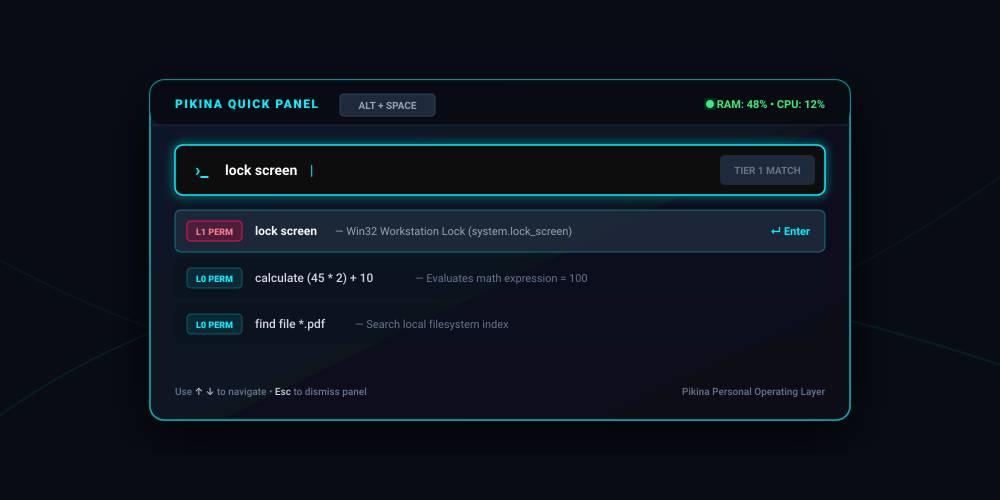
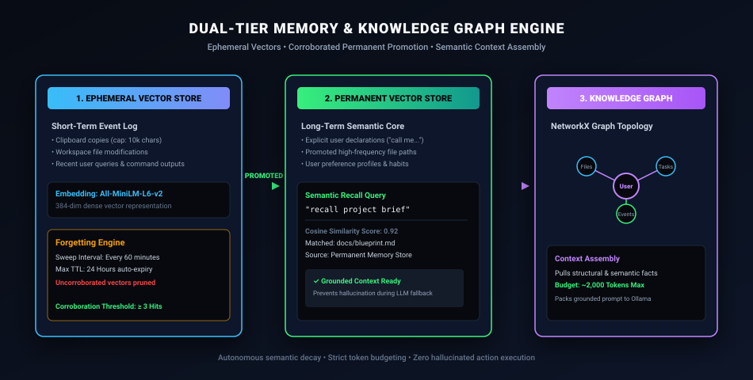
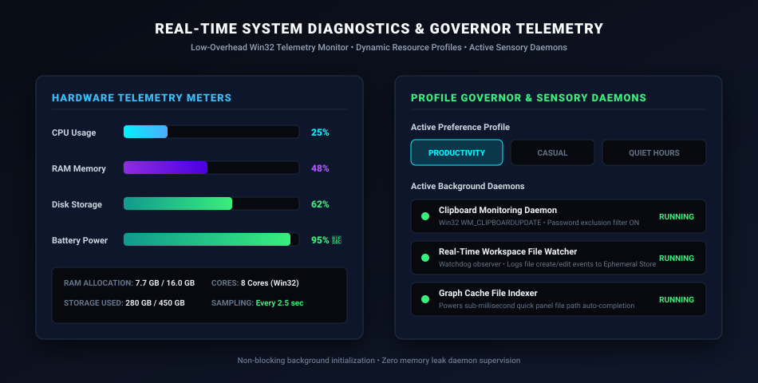
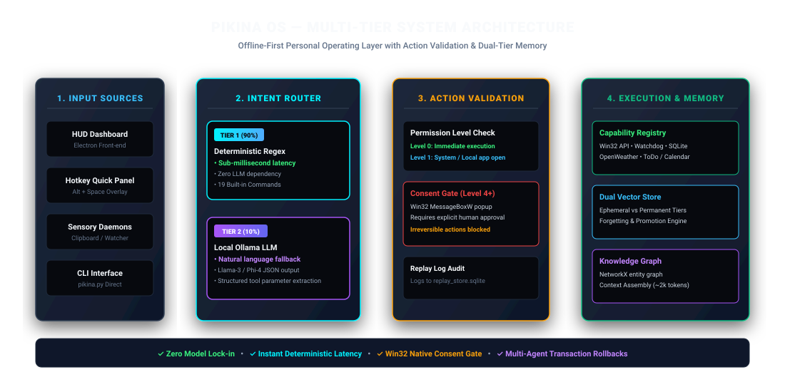
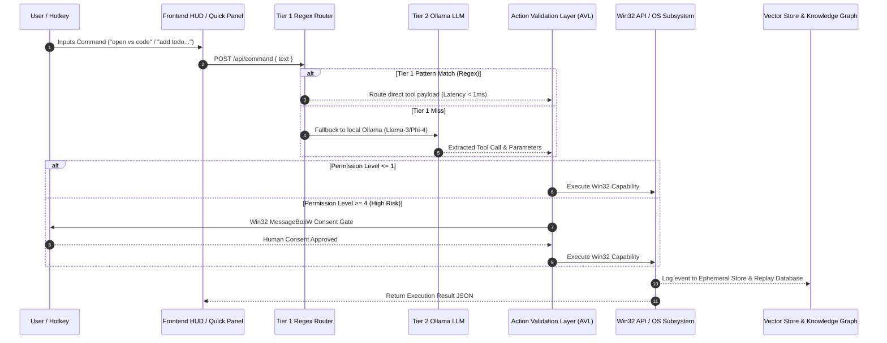

<div align="center">

# ⚡ PIKINA OS

### *Offline-First, Event-Driven Personal Operating Layer for Windows*

[](#-active-development--trial-phase-notice)
[](https://python.org)
[](https://electronjs.org)
[](https://microsoft.com/windows)
[](file:///home/kskroyal/Projects/pik/Pikina/core/router)
[-FF0844?style=for-the-badge)](file:///home/kskroyal/Projects/pik/Pikina/security)
[](#license)

<br/>

> *"Language models are lazy-loaded reasoning services sitting on top of deterministic infrastructure — not the thing the infrastructure depends on."*

<br/>


</div>

---

> [!WARNING]
> ### 🚧 Active Development & Experimental Trial Phase Notice
> **Pikina OS is currently in an active pre-alpha engineering and experimental trial phase.**
> - Subsystems and capability APIs are continuously undergoing refinement, trial testing, and optimization.
> - Current operational status corresponds to **Phase 4e** (Sensory Daemons, Event Bus, Action Validation Layer, and Dual Memory Engine active).
> - Features marked as active or pending in the roadmap below are subject to continuous trial iterations. Feedback and trial logs are welcome!

---

## 📖 Table of Contents

- [Active Development & Trial Notice](#-active-development--experimental-trial-phase-notice)
- [Overview & Core Philosophy](#-overview--core-philosophy)
- [Visual Interface & Subsystem Showcase](#-visual-interface--subsystem-showcase)
  - [1. JARVIS HUD Dashboard](#1-jarvis-hud-dashboard-frontenddashboard)
  - [2. Hotkey Quick Panel Overlay](#2-hotkey-quick-panel-overlay-frontendquick_panel)
  - [3. Action Validation & Consent Gate](#3-action-validation--win32-consent-gate-security)
  - [4. Dual-Tier Memory & Knowledge Graph](#4-dual-tier-memory--knowledge-graph-memory)
  - [5. System Diagnostics & Sensory Telemetry](#5-system-diagnostics--sensory-telemetry-coregovernor)
- [System Architecture & Routing Pipeline](#-system-architecture--routing-pipeline)
- [Build Roadmap & Phase Status](#-build-roadmap--phase-status)
- [Capability Registry & Command Specs](#-capability-registry--command-specs)
- [Subsystems Deep Dive](#-subsystems-deep-dive)
  - [1. Two-Tier Command Router](#1-two-tier-command-router)
  - [2. Action Validation Layer (AVL) & Security](#2-action-validation-layer-avl--security)
  - [3. Dual-Tier Vector Memory & Knowledge Graph](#3-dual-tier-vector-memory--knowledge-graph)
  - [4. Sensory Daemons & File Indexer](#4-sensory-daemons--file-indexer)
- [Repository Layout](#-repository-layout)
- [Tech Stack Reference](#-tech-stack-reference)
- [Quick Start Guide](#-quick-start-guide)
- [Commit & Contribution Conventions](#-commit--contribution-conventions)

---

## 🌟 Overview & Core Philosophy

**Pikina OS** is a lightweight, zero-latency, offline-first personal operating system layer engineered for Windows. It acts as an intelligent intermediary between user intent, operating system APIs, and local/cloud artificial intelligence models.

Unlike conventional AI desktop assistants that route every keystroke through cloud-hosted LLMs, Pikina OS is built on a **deterministic-first paradigm**:

> [!IMPORTANT]
> **Pikina OS Guiding Design Principles**
> 1. **Infrastructure Before Intelligence:** Every core subsystem (file access, task tracking, application launching, calendar sync, stopwatch, math evaluation) works seamlessly with **zero LLMs active**.
> 2. **Sub-Millisecond Deterministic Latency:** Commands matching structured patterns route via sub-millisecond C/Python regex matches without waiting for LLM inference.
> 3. **Action Validation Layer (AVL):** Untrusted data never self-executes. High-risk operations (Level 4+) mandate explicit native Windows confirmation popups (`MessageBoxW`).
> 4. **Irreversibility Focus:** Actions with non-reversible side effects carry higher permission bounds than simple data reads.
> 5. **Dual Memory Store with Auto-Decay:** Short-term sensory events auto-expire, while frequently corroborated events get promoted to permanent semantic storage.

---

## 🎨 Visual Interface & Subsystem Showcase

### 1. JARVIS HUD Dashboard (`frontend/dashboard`)
A futuristic, dark-mode visual interface featuring diagnostic telemetry bars for CPU, RAM, Disk, and Battery, an active arc-reactor status core, real-time event replay stream, objective tracker, and mini calendar.


### 2. Hotkey Quick Panel Overlay (`frontend/quick_panel`)
A lightweight, floating command launcher accessible anywhere on Windows via <kbd>Alt</kbd> + <kbd>Space</kbd>. Provides instant search suggestions, system status indicators, and sub-millisecond command execution.



### 3. Action Validation & Win32 Consent Gate (`security`)
Intercepts elevated permission requests ($L4+$) and irreversible side effects before execution, triggering native Win32 `MessageBoxW` confirmation modals.


### 4. Dual-Tier Memory & Knowledge Graph (`memory`)
Visualizes the automated vector flow: Ephemeral Store (short-term clipboard & file edits) $\rightarrow$ Promotion Sweep ($\ge 3$ corroborations) $\rightarrow$ Permanent Semantic Store & NetworkX Knowledge Graph.



### 5. System Diagnostics & Sensory Telemetry (`core/governor`)
Real-time Win32 hardware sampling, active preference profiles (`Productivity`, `Casual`, `Quiet Hours`), and active sensory background daemons.



---

## 🏗️ System Architecture & Routing Pipeline

Pikina OS isolates reasoning from execution. Incoming inputs pass through a strict four-stage pipeline: **Sourcing** $\rightarrow$ **Two-Tier Routing** $\rightarrow$ **Action Validation** $\rightarrow$ **Execution & Audit**.



### Data Execution Flow (Mermaid Sequence)



---

## 🗓️ Build Roadmap & Phase Status

| Phase | Subsystems & Description | Status |
|:---:|:---|:---:|
| **1 — Foundation** | Local Event Bus, Tier 1 Deterministic Router, Permission Engine, Capability Registry | ✅ Completed |
| **1.5 — Frontend** | Hotkey Quick Panel overlay, Home Dashboard (JARVIS HUD), Backend REST API Server | ✅ Completed |
| **2 — Sensory** | Win32 Clipboard Daemon (`WM_CLIPBOARDUPDATE`), Real-time File Watcher, File Indexer | ✅ Completed |
| **3 — Memory** | Trust Engine, Ephemeral & Permanent Vector Memory, Forgetting Engine, Knowledge Graph | 🧪 Trial / Active |
| **4 — Reasoning** | Tier 2 Local LLM Fallback (Ollama), Tier 3 Metered Reasoning, Multi-Agent Planner | 🧪 Trial / Active |
| **5 — Voice & Vision** | Local STT (Whisper.cpp), TTS (Kokoro-82M), Screen Vision (`mss` + Gemini Flash) | ⏳ Planned |
| **6 — Vault** | AES-256 Encrypted Vault (`cryptography.fernet`), Playwright Web Automation | ⏳ Planned |

---

## ⚡ Capability Registry & Command Specs

Pikina OS provides **19 built-in capabilities** spanning system controls, task management, calendar integration, math calculations, and file searches.

### Safety Permission Levels

- **Level 0 (Low Risk):** Read-only calculations, queries, listing items. Executes instantly.
- **Level 1 (Medium Risk):** Modifies local application states, toggles settings, launches local executables.
- **Level 4+ (High Risk):** Modifies system configurations, deletes data, or performs non-reversible operations. **Triggers a native Windows popup confirmation dialog before execution.**

```markdown
┌──────────────────────┬───────┬────────────────────────────────────────────────────────┐
│ Capability ID        │ Level │ Example Command Syntax                                 │
├──────────────────────┼───────┼────────────────────────────────────────────────────────┤
│ app.open             │   1   │ "open notepad", "start calc", "launch vs code"         │
│ fs.find_file         │   0   │ "find file resume.pdf", "search for *.csv"             │
│ todo.add             │   0   │ "add todo call project sponsor", "todo buy groceries"  │
│ todo.complete        │   0   │ "mark task buy groceries as done", "complete c693836e" │
│ todo.list            │   0   │ "list todos", "show done tasks", "list all tasks"      │
│ todo.remove          │   1   │ "remove todo buy groceries", "delete task c693836e"    │
│ calendar.add_event   │   0   │ "add event meeting on 2026-07-20 at 14:00"             │
│ calendar.query       │   0   │ "what do I have this week", "what is on 2026-07-20"    │
│ calendar.update_event│   0   │ "change check-in time to 15:00"                        │
│ calendar.remove_event│   1   │ "remove event project check-in"                        │
│ calendar.import_ics  │   0   │ "import ics C:\Users\user\Downloads\invite.ics"        │
│ alias.add            │   0   │ "add alias morning -> start stopwatch ; open notepad"  │
│ alias.list           │   0   │ "list aliases", "show aliases"                         │
│ alias.remove         │   1   │ "remove alias morning"                                 │
│ prefs.update         │   0   │ "call me Aditya", "be formal", "quiet hours 22 to 08"  │
│ memory.recall        │   0   │ "recall what I did yesterday", "where is project brief"│
│ utility.calculate    │   0   │ "calculate (45 * 2) + 10", "calc 12 * 8"               │
│ utility.stopwatch    │   0   │ "start stopwatch", "pause stopwatch", "reset stopwatch"│
│ system.lock_screen   │   1   │ "lock screen", "lock workstation", "lock pc"           │
└──────────────────────┴───────┴────────────────────────────────────────────────────────┘
```

---

## 🛠️ Subsystems Deep Dive

### 1. Two-Tier Command Router

Pikina OS employs an automated multi-tier routing pipeline located in [`core/router`](file:///home/kskroyal/Projects/pik/Pikina/core/router):

1. **Tier 1 (Deterministic Router):**
   Evaluates commands against compiled regex patterns. If matched, execution completes in **$< 1\text{ ms}$** without invoking AI models or consuming GPU/CPU compute.
2. **Tier 2 (Local LLM Fallback):**
   If no regex matches, the command is dispatched to a local **Ollama** service (running models like `phi4` or `qwen2.5`). The LLM returns structured JSON matching capability signatures.
3. **Graceful `no_match` Handling:**
   Out-of-scope prompts yield an explicit `no_match` response, preventing hallucinated file deletions or execution errors.

### 2. Action Validation Layer (AVL) & Security

Located in [`security`](file:///home/kskroyal/Projects/pik/Pikina/security) and [`core/validation`](file:///home/kskroyal/Projects/pik/Pikina/core/validation):

- **Permission Level Enforcement:** Validates that the requested tool parameter level does not exceed the allowed threshold.
- **Consent Gate (`MessageBoxW`):** Any Level 4+ or non-reversible action halts execution and raises a native Windows modal confirmation.
- **Replay Store Audit:** Every execution, approval, rejection, and error is appended to `replay_store.sqlite` for complete operational auditability.
- **Multi-Step Rollback Manager:** In alias chains (`step1 ; step2`), if any step fails, execution halts and triggers reverse-order LIFO rollback callbacks.

### 3. Dual-Tier Vector Memory & Knowledge Graph

Located in [`memory`](file:///home/kskroyal/Projects/pik/Pikina/memory):

- **Ephemeral Vector Store:** Captures short-term file modifications, clipboard contents, and system logs.
- **Permanent Vector Store:** Holds explicit declarations, user preferences, and promoted memories.
- **Promotion & Forgetting Engine:**
  - *Promotion:* Events corroborated $\ge 3$ times in the Ephemeral Store are promoted to Permanent storage.
  - *Forgetting:* Automated background sweeps decay and purge stale ephemeral vectors.
- **Knowledge Graph:** Tracks structural relationships between files, topics, tasks, and people using NetworkX serialized to JSON.
- **Context Assembly:** Assembles relevant facts within a strict 2,000-token budget to ground LLM reasoning.

### 4. Sensory Daemons & File Indexer

Located in [`daemons`](file:///home/kskroyal/Projects/pik/Pikina/daemons):

- **Clipboard Monitor (`ClipboardDaemon`):** Listens to Windows `WM_CLIPBOARDUPDATE` messages. Automatically ignores content marked sensitive by password managers (`ExcludeClipboardContentFromMonitor`) and enforces a 10,000-character cap.
- **File Watcher (`FileWatcherDaemon`):** Tracks file creation, modifications, and deletions in real-time using `watchdog`.
- **File Indexer (`FileIndexerDaemon`):** Maintained via `GraphCache` to power instant fuzzy auto-completion for local files and folders.

---

## 📂 Repository Layout

```
Pikina/
├── backend_server.py           # Flask REST API server (localhost:5001)
├── pikina.py                   # Terminal CLI entry point
├── core/
│   ├── eventbus/               # Local Event Bus & Replay Log Store
│   ├── governor/               # System Telemetry & Profile Governor
│   ├── mcm/                    # Meta-Cognitive Manager (Orchestrator)
│   ├── memory/                 # Vector Memory & Knowledge Graph
│   ├── registry/               # Capability Registry & Tool Implementation
│   ├── router/                 # Tier 1 Regex & Tier 2 Ollama Routers
│   ├── validation/             # Action Validation Layer (AVL) & Consent Gate
│   ├── daemons/                # Clipboard, File Watcher, and Indexer Daemons
│   ├── calendar/               # Calendar store & ICS importer
│   └── todo/                   # SQLite ToDo Store
├── frontend/
│   ├── dashboard/              # JARVIS HUD Dashboard (HTML/CSS/JS)
│   ├── quick_panel/            # Alt+Space Hotkey Overlay Window
│   └── shared/                 # Common themes, styles & assets
├── docs/
│   ├── assets/                 # High-resolution vector diagrams & UI mockups
│   └── pikina_user_manual.md   # Comprehensive User Manual (Phase 4e)
├── security/                   # Security policies & Vault implementations
├── tests/                      # Per-subsystem test suites
└── requirements.txt            # Python dependencies
```

---

## 💻 Tech Stack Reference

| Subsystem Layer | Technology / Library | Purpose |
|:---|:---|:---|
| **OS Automation & Hooks** | `pywin32`, `ctypes` | Native Windows Win32 API interaction |
| **File System Monitoring** | `watchdog` | Real-time workspace file modification events |
| **Frontend UI Framework** | `Electron` | Frameless desktop HUD & Quick Panel windows |
| **Backend REST Service** | `Flask`, `Flask-CORS` | High-speed IPC bridge between Python & Electron |
| **Audit & Replay Log** | `SQLite3` | Persistent replay log of all system actions |
| **Local LLM Service** | `Ollama` (`llama3`, `phi4`) | Tier 2 natural language tool parameter extraction |
| **Vector Embeddings** | `SentenceTransformers` (`All-MiniLM-L6-v2`) | Semantic memory representation & retrieval |
| **Knowledge Graph** | `NetworkX` | Entity relationship mapping |
| **Speech & Voice** | `Whisper.cpp`, `Kokoro-82M` | Offline Speech-to-Text & Text-to-Speech |
| **Vision Capture** | `mss`, `Gemini Flash API` | Screen capture & visual analysis |
| **Encryption & Vault** | `cryptography.fernet` (AES-256) | Encrypted key/value storage |
| **System Telemetry** | `psutil` | CPU, RAM, Disk, and Battery diagnostics |

---

## 🚀 Quick Start Guide

### Prerequisites

- **OS:** Windows 10 or Windows 11 (64-bit)
- **Python:** Version 3.10 or higher
- **Node.js:** Version 18.0 or higher
- **Ollama (Optional for Tier 2 reasoning):** [Ollama for Windows](https://ollama.com)

### 1. Clone & Environment Setup

```bash
git clone https://github.com/Aditya2514/Pikina.git
cd Pikina

# Create and activate Python virtual environment
python -m venv venv
venv\Scripts\activate

# Install dependencies
pip install -r requirements.txt
```

### 2. Configure Environment Variables

Create a `.env` file in the root directory (or copy from `.env.example`):

```ini
BACKEND_PORT=5001
OPENWEATHER_API_KEY=your_openweather_key_here
OPENWEATHER_CITY=Mumbai
```

### 3. Launch Backend API Server

```bash
python backend_server.py
```
*Output:*
```text
================================================───
  Pikina OS Backend  —  http://localhost:5001
  Profile : productivity
  Weather : Mumbai
================================================───
```

### 4. Launch Desktop Frontend (Electron)

In a separate terminal window:

```bash
cd frontend
npm install
npm start
```

### 5. Alternative: Interactive Terminal CLI Mode

Run Pikina directly in terminal mode without launching the GUI:

```bash
python pikina.py
```

---

## 🤝 Commit & Contribution Conventions

When committing changes, adhere to the project phase convention:

```text
phase1.1: implement capability registry and event bus
phase1.5a: build electron quick panel and backend websocket bridge
phase2.1: integrate win32 clipboard daemon with vector store
```

### Running Tests

```bash
# Run all subsystem tests
pytest tests/
```

---

## 📜 License

Distributed under the **MIT License**. See `LICENSE` for more information.

<div align="center">

**Built with precision for offline sovereignty & human-in-the-loop safety.**

</div>
